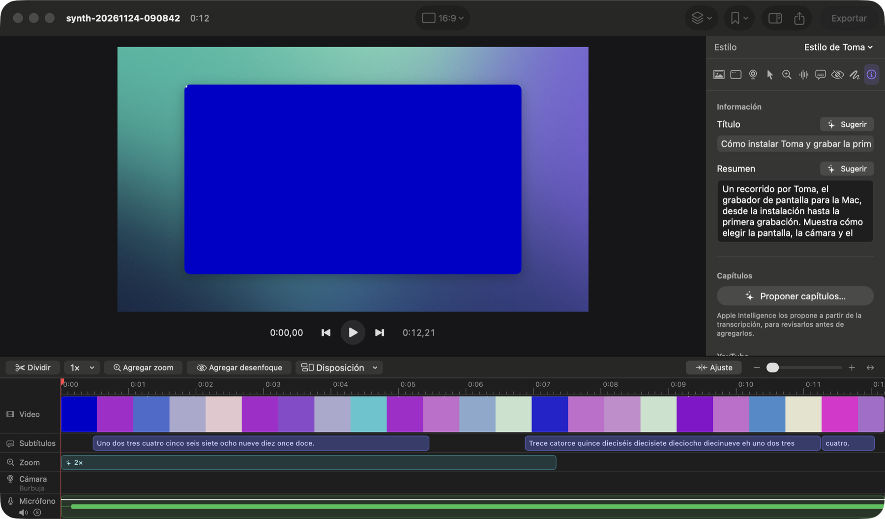

# Toma

[English](README.md) · **Español**

Grabador de pantalla nativo y de código abierto para macOS (Apple silicon, macOS 15 o superior). Graba, hace zoom solo,
edita y exporta, sin suscripción y sin que nada salga de la Mac.



> **Estado: versión previa.** Todo lo de abajo está construido y con pruebas automáticas (unas 4.000), pero faltan
> pruebas de uso real: puede haber detalles sin pulir, y conviene reportarlos.

## Qué hace

- **Graba sin perder nada.** Pantalla, ventana, área, varias pantallas, iPhone o iPad por cable, cámara, micrófono y audio
  del sistema con una pista por app. Cada pista se escribe en fragmentos: si la Mac se apaga o la app se cierra de golpe,
  la toma se recupera hasta el último segundo.
- **Se controla desde el notch.** Una isla bajo el notch elige qué grabar, muestra el tiempo y el micrófono, y lleva el
  teleprompter, que puede seguir la voz.
- **Hace zoom solo.** Sigue los clics y, con el permiso de Accesibilidad, lo que se escribe y los campos que se alcanzan
  con el teclado. Además del zoom clásico tiene modos tranquilos: resaltar, atenuar y lupa.
- **Edita por la transcripción.** Subtítulos, cortar borrando palabras, quitar muletillas y acortar pausas, con la
  transcripción hecha en la Mac.
- **Termina el video adentro.** Fondos, marcos de dispositivo, cursor redibujado, disposiciones de cámara, anotaciones,
  placas de título, congelar un cuadro, imágenes y clips, música con ducking, marcadores y capítulos, y regrabar un tramo
  sin perder lo grabado.
- **Cuida la privacidad.** Desenfoque manual y búsqueda automática de datos sensibles, teclas en pantalla que nunca
  graban campos de contraseña, y fondo de la cámara recortado o desenfocado.
- **Exporta para todo.** MP4 (H.264, HEVC), ProRes, GIF, video con fondo transparente (HEVC con alfa, ProRes 4444) y
  metadatos para editores (FCPXML y JSON con cursor, clics y zooms).
- **Se automatiza.** Un formato de proyecto documentado, la línea de comandos `toma` y un servidor MCP: un agente puede
  editar y exportar un proyecto sin abrir la app. Ver [docs/automation.md](docs/automation.md).
- **Comparte con tu propio almacenamiento.** Sube el video a un bucket compatible con S3 (R2, S3, B2, MinIO) y da un link
  con su página. No hay hosting de Toma.
- **IA en la Mac.** Capítulos, título y resumen propuestos por el modelo del sistema (macOS 26 con Apple Intelligence).
  Siempre se revisan antes de aplicarse.
- **Repetición.** Guarda los últimos 15 s a 5 min como un proyecto completo, con un atajo.

## Por qué otro grabador

- **Nativo:** Swift, SwiftUI, AppKit y Metal. Sin Electron.
- **Abierto:** GPL-3.0-or-later, con el formato de proyecto documentado ([docs/format](docs/format/README.md)).
- **Sin suscripción y sin nube:** nada sale de la Mac salvo lo que se sube, a pedido, al almacenamiento propio.
- **Ninguna toma se pierde:** es la prioridad del diseño.

## Instalar

1. Bajar `Toma-<versión>.dmg` de la página de [Releases](../../releases/latest).
2. Abrir el DMG y arrastrar Toma a Aplicaciones.
3. Abrir Toma. La primera vez macOS no la deja abrir, porque Toma no está notarizada por Apple (el proyecto no paga la cuenta de desarrollador de Apple): avisa que no puede comprobar que Toma esté libre de software malicioso.
4. Ir a Ajustes del Sistema → Privacidad y seguridad. En la sección Seguridad aparece un mensaje sobre Toma: elegir "Abrir igualmente" y confirmar. Hace falta una sola vez.

Toma se firma siempre con el mismo certificado propio del proyecto ("Toma Project Signing"), para que macOS la reconozca como la misma app en cada versión y no vuelva a pedir los permisos de grabación de pantalla y micrófono al actualizar (a confirmar en la verificación 1 de [docs/release.md](docs/release.md#verificaciones-del-dueño)).

## Compilar desde el código

Requiere Xcode 27 (gratis en la App Store) y [XcodeGen](https://github.com/yonaskolb/XcodeGen) (`brew install xcodegen`).

```sh
make install
```

`make install` genera el proyecto, compila en Release y copia `Toma.app` a `/Applications` (reemplaza la que haya: hace falta una cuenta de administrador). Como se compila en la propia Mac, macOS debería abrirla sin aviso (a confirmar en la verificación 4 de [docs/release.md](docs/release.md#verificaciones-del-dueño)).

## Actualizaciones

Toma busca actualizaciones con [Sparkle](https://sparkle-project.org): una vez por día si se acepta cuando lo pregunta, o cuando se elige "Buscar actualizaciones…" en su menú de la barra de menús. Cada actualización viene firmada con la clave EdDSA del proyecto, y Sparkle rechaza una actualización que no tenga esa firma ni la misma firma de código que la app instalada. Mientras se graba no se buscan actualizaciones, para que ninguna ventana de Sparkle aparezca en la grabación: "Buscar actualizaciones…" está desactivado, y la búsqueda diaria que toque durante la toma se hace al terminarla. Una actualización que ya se está instalando espera a que termine la grabación para volver a abrir la app.

Una copia compilada desde el código se actualiza compilando de nuevo: `git pull && make install`. Pero desde que la clave pública de Sparkle está en `Config/Identity.xcconfig`, esa copia también corre Sparkle y puede actualizarse sola a la versión del DMG, firmada con el certificado del proyecto. La copia compilada no está firmada con ese certificado, así que esa vez macOS la ve como otra app y vuelve a pedir los permisos, una sola vez: las versiones siguientes ya vienen firmadas igual (a confirmar en la verificación 1).

Las actualizaciones salen de las Releases de este repositorio: la app lee `releases/latest/download/appcast.xml`. Ver [docs/release.md](docs/release.md).

## No Molestar durante las grabaciones

Las notificaciones nunca salen en el video, y sus sonidos tampoco en el audio del sistema. Para que además no aparezcan ni suenen mientras se graba, Toma puede activar No Molestar con un atajo propio de la app Atajos (Shortcuts): lo corre con el texto `on` antes de la cuenta regresiva y, solo si el atajo lo activó (o no terminó a tiempo, por si lo activó tarde), con `off` al terminar la grabación (también si se cancela la cuenta). Si Toma se cierra de golpe en medio de una toma, o si `off` no pudo correr, lo corre con `off` al volver a abrirse o al terminar la grabación siguiente. Toma no trae un atajo hecho; se crea una sola vez:

1. En Atajos, crear un atajo nuevo (por ejemplo, "No Molestar para Toma") que reciba texto.
2. Si el texto es `on`: si "Obtener el Focus actual" no da ninguno, activar No Molestar y devolver el texto `changed`. Si ya había un Focus activo, no devolver nada: así Toma lo deja como estaba al terminar.
3. Si el texto es `off`: desactivar No Molestar.
4. Correrlo una vez a mano desde Atajos para dar sus permisos: un diálogo de permiso en la primera corrida desde Toma vencería el plazo de 5 s, y la grabación seguiría sin No Molestar (la isla lo avisa, y al terminar Toma lo corre con `off`).
5. Elegirlo en Ajustes de Toma, en "Activar No Molestar con un atajo", o con el interruptor No Molestar de los Ajustes de la isla. Toma guarda el identificador del atajo, que no cambia si se le cambia el nombre.

## Desarrollo / Development

Ver [CONTRIBUTING.md](CONTRIBUTING.md). `make test` corre las pruebas.
