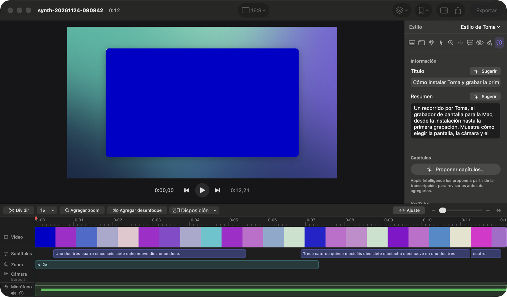

# Toma

**English** · [Español](README.es.md)

A native, open-source screen recorder for macOS (Apple silicon, macOS 15 or later). It records, zooms by itself, edits
and exports, with no subscription and nothing leaving your Mac.



> **Status: pre-release.** Everything below is built and covered by automated tests (about 4,000), but there is no
> signed download yet: for now you build it from source. It still needs real-world use, so expect rough edges and
> please report them.

The app's interface is in English and Spanish; the screenshots here show it in Spanish.

## What it does

- **Records without losing anything.** Display, window, area, several displays, an iPhone or iPad over a cable, camera,
  microphone and system audio with one track per app. Every track is written in fragments: if the Mac loses power or the
  app is killed, the take is recovered up to its last second.
- **Lives in the notch.** An island under the notch picks what to record, shows the time and the microphone, and holds
  the teleprompter, which can follow your voice.
- **Zooms by itself.** It follows clicks and, with the Accessibility permission, what you type and the fields you reach
  with the keyboard. Besides the classic zoom it has calm modes: highlight, dim and a loupe.
- **Edits by the transcript.** Captions, cutting by deleting words, removing filler words and shortening pauses, with the
  transcription done on the Mac.
- **Finishes the video inside.** Backgrounds, device frames, a redrawn cursor, camera layouts, annotations, title cards,
  frozen frames, images and clips, music with ducking, markers and chapters, and re-recording a stretch without losing
  what was recorded.
- **Cares for privacy.** Manual blur and an automatic search for sensitive data, on-screen keys that never record
  password fields, and a camera background that can be removed or blurred.
- **Exports for everything.** MP4 (H.264, HEVC), ProRes, GIF, video with a transparent background (HEVC with alpha,
  ProRes 4444) and metadata for editors (FCPXML and JSON with the cursor, clicks and zooms).
- **Can be automated.** A documented project format, the `toma` command line and an MCP server: an agent can edit and
  export a project without opening the app. See [docs/automation.md](docs/automation.md) (in Spanish).
- **Shares to your own storage.** It uploads the video to an S3-compatible bucket (R2, S3, B2, MinIO) and gives you a
  link with its page. There is no Toma hosting.
- **On-device AI.** Chapters, a title and a summary proposed by the system's model (macOS 26 with Apple Intelligence).
  You always review them before they are applied.
- **Replay.** Saves the last 15 s to 5 min as a full project, with a shortcut.

## Why another recorder

- **Native:** Swift, SwiftUI, AppKit and Metal. No Electron.
- **Open:** GPL-3.0-or-later, with a documented project format ([docs/format](docs/format/README.md), in Spanish).
- **No subscription, no cloud:** nothing leaves the Mac except what you upload, when you ask, to your own storage.
- **No take is ever lost:** it is the design's first priority.

## Build from source

You need Xcode 27 (free on the App Store) and [XcodeGen](https://github.com/yonaskolb/XcodeGen)
(`brew install xcodegen`).

```sh
make install
```

`make install` generates the project, builds in Release and copies `Toma.app` to `/Applications` (it replaces the one
there, so it needs an administrator account). To build without installing, `make build` leaves a Debug app in
`build/Build/Products/Debug/`.

A copy built on your own Mac is signed ad hoc. macOS treats each new build as another app, so it asks again for the
screen recording, microphone and camera permissions after you rebuild.

## Automate it

`Toma.app` carries the command line inside (`Toma.app/Contents/Helpers/toma`); Settings ▸ General can install a link to
it.

```sh
toma info Demo.toma                                    # takes, sequence, markers, zoom, transcript
toma edit Demo.toma '{"command": "cut", "from": 12.5, "to": 14}'
toma export Demo.toma demo.mp4 --codec hevc --size 1080
claude mcp add toma -- toma mcp                        # give the same tools to an agent over MCP
```

Every command is the same step its gesture makes in the editor, and can be undone with `toma undo`.

## Documentation

- [docs/automation.md](docs/automation.md): the command line and the MCP server.
- [docs/format/README.md](docs/format/README.md): the project format (version 1.0), its JSON schemas and examples.
- [docs/music.md](docs/music.md): the built-in music library, synthesized in code and released as CC0.
- [docs/release.md](docs/release.md): how releases are signed and built, and the manual checks still pending.

These documents are in Spanish for now. Translations are welcome.

## Contributing

See [CONTRIBUTING.md](CONTRIBUTING.md). `make test` runs the package's tests. Commits carry a `Signed-off-by` line
(DCO).

## License

GPL-3.0-or-later. See [LICENSE](LICENSE); the app's "Third-Party Licenses…" menu item lists the licenses of what it
includes.
